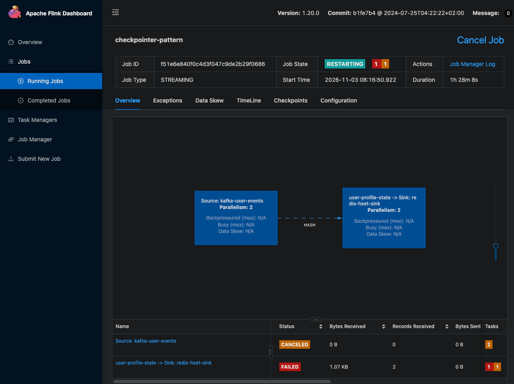
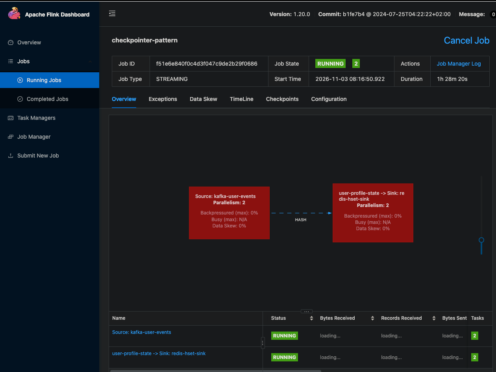
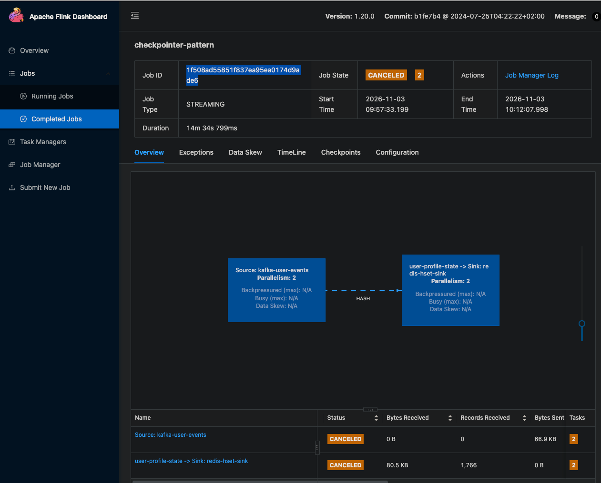
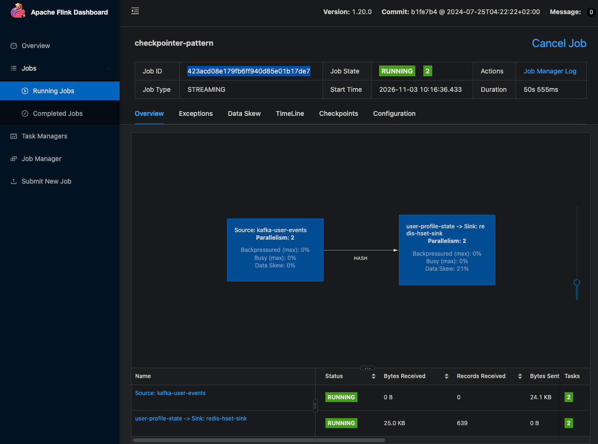

# 事前確認
```
at 08:16:51 ❯ docker compose exec redis redis-cli HGETALL 3
docker compose exec redis redis-cli --scan          # all user keys
1) "update_count"
2) "21"
3) "favorite_food"
4) "ramen"
5) "name"
6) "Carol"
"3"
"5"
"4"
"9"
"6"
"10"
"1"
"2"
"7"
"8"
```
```
at 08:19:26 ❯ docker compose exec jobmanager ls -R /opt/flink/checkpoints | head
/opt/flink/checkpoints:
434a108e79773a825c31f551b8ede1ee
eecbecf38b1da6c3b2b70c4bfb3a232a
f51e6e840f0c4d3f047c9de2b29f0686

/opt/flink/checkpoints/434a108e79773a825c31f551b8ede1ee:
chk-176
chk-177
chk-178
shared

```
# テスト1
実際に処理するTaskManagerがkillされて再開したときに、JobManager主導で途中のcheckpointから再開できるか動作確認
```
at 08:19:56 ❯ docker compose exec redis redis-cli HGET 3 update_count   # note the value
docker compose kill taskmanager
sleep 15
docker compose start taskmanager
"53"
[+] Killing 1/1
 ✔ Container flink-checkpointer-taskmanager-1  Killed                                                                                                    0.1s
[+] Running 2/2
 ✔ Container flink-checkpointer-jobmanager-1   Healthy                                                                                                   0.5s
 ✔ Container flink-checkpointer-taskmanager-1  Started                                                                                                   0.1s

at 08:22:01 ❯ docker compose logs jobmanager | grep -i "restoring job"
jobmanager-1  | 2026-11-02 23:22:06,204 INFO  org.apache.flink.runtime.checkpoint.CheckpointCoordinator    [] - Restoring job f51e6e840f0c4d3f047c9de2b29f0686 from Checkpoint 29 @ 1793661696706 for f51e6e840f0c4d3f047c9de2b29f0686 located at file:/opt/flink/checkpoints/f51e6e840f0c4d3f047c9de2b29f0686/chk-29.

at 08:22:10 ❯ docker compose exec redis redis-cli HGET 3 update_count   # note the value
"79"

```

# テスト2
```
at 09:43:49 ❯ docker compose stop redis
sleep 30
docker compose start redis     # the job recovers from the last successful checkpoint
[+] Stopping 1/1
 ✔ Container flink-checkpointer-redis-1  Stopped                                                                                                         0.2s
[+] Running 1/1
 ✔ Container flink-checkpointer-redis-1  Started                                                                                                         0.1s
```



# テスト3
ジョブをcancelした後にcheckpointを引き継いで別ジョブを実行開始できるか動作確認
update_countの状態をcheckpointとして保持できている。
```
JOB_ID=$(docker compose exec -T jobmanager flink list -r 2>/dev/null \
  | awk '/checkpointer-pattern \(RUNNING\)/ {print $4; exit}')
echo "$JOB_ID"

docker compose exec -T jobmanager flink cancel "$JOB_ID" 2>/dev/null
1f508ad55851f837ea95ea0174d9ade6
Cancelling job 1f508ad55851f837ea95ea0174d9ade6.
Cancelled job 1f508ad55851f837ea95ea0174d9ade6.

at 10:12:08 ❯ CHK=$(docker compose exec -T jobmanager sh -c "ls -d /opt/flink/checkpoints/$JOB_ID/chk-* | sort -V | tail -1")
echo "$CHK"

# No job writes to Redis now, so this value stays fixed
docker compose exec -T redis redis-cli HGET 3 update_count
/opt/flink/checkpoints/1f508ad55851f837ea95ea0174d9ade6/chk-682
1407

at 10:12:19 ❯ docker compose run --rm --no-deps job-submitter flink run -t local \
  -c com.example.checkpointer.CheckpointStateReader /opt/flink/usrlib/flink-checkpointer.jar \
  --checkpoint.path "file://$CHK" 2>/dev/null
WARNING: Unknown module: jdk.compiler specified to --add-exports
WARNING: Unknown module: jdk.compiler specified to --add-exports
WARNING: Unknown module: jdk.compiler specified to --add-exports
WARNING: Unknown module: jdk.compiler specified to --add-exports
WARNING: Unknown module: jdk.compiler specified to --add-exports
Job has been submitted with JobID ddd39f5ce88624f9085aed8cd7a5494f
checkpoint: file:///opt/flink/checkpoints/1f508ad55851f837ea95ea0174d9ade6/chk-682
user_id update_count
1       1348
2       1323
3       1405
4       1342
5       1425
6       1476
7       1389
8       1406
9       1383
10      1353
total   13850
```


ジョブキャンセル後に別ジョブをスタートすると以前のジョブのcheckpointを引き継いでくれた。
```
at 10:12:51 ❯ NEW_JOB_ID=$(docker compose exec -T jobmanager flink run -d -s "$CHK" \
  /opt/flink/usrlib/flink-checkpointer.jar --kafka.brokers kafka:9092 --redis.host redis 2>/dev/null \
  | awk '/submitted with JobID/ {print $NF}')
echo "$NEW_JOB_ID"

# Flink logs a checkpoint passed with -s as a "savepoint"
docker compose logs jobmanager | grep "$NEW_JOB_ID" | grep "from savepoint"
423acd08e179fb6ff940d85e01b17de7
jobmanager-1  | 2026-11-03 01:16:36,463 INFO  org.apache.flink.runtime.checkpoint.CheckpointCoordinator    [] - Starting job 423acd08e179fb6ff940d85e01b17de7 from savepoint /opt/flink/checkpoints/1f508ad55851f837ea95ea0174d9ade6/chk-682 ()

at 10:16:36 ❯ docker compose exec -T redis redis-cli HGET 3 update_count
1469
```

